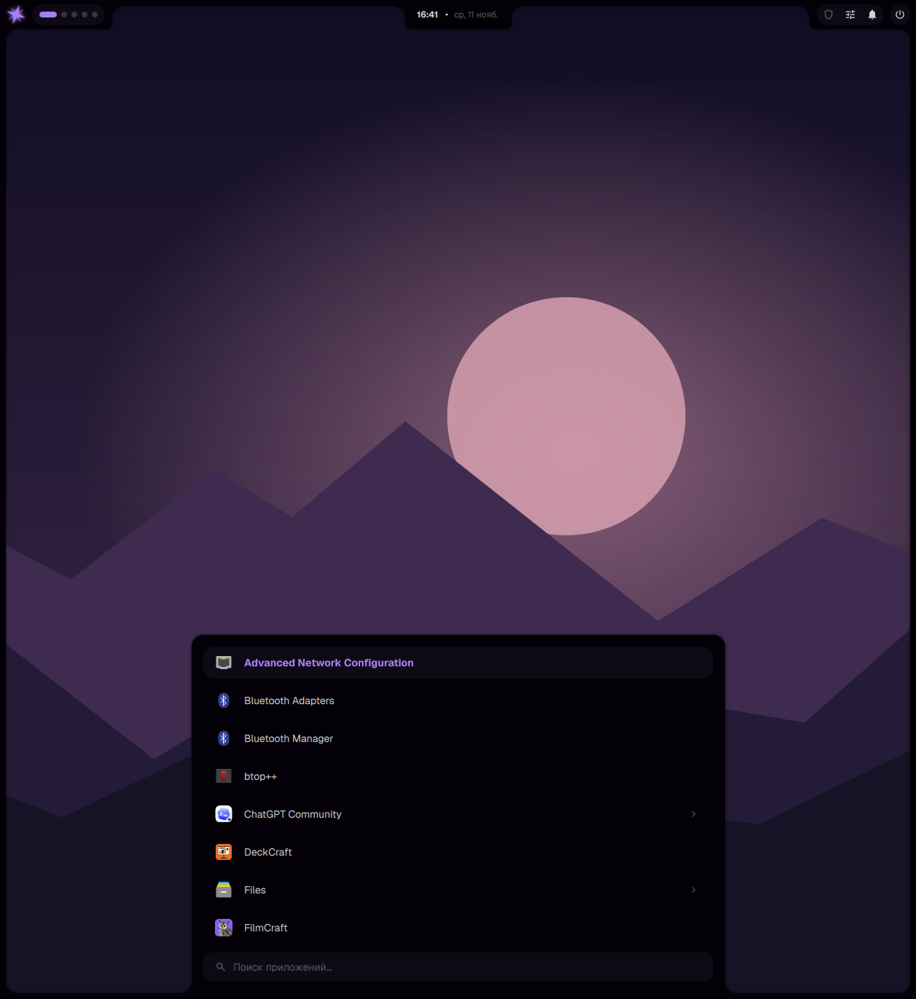
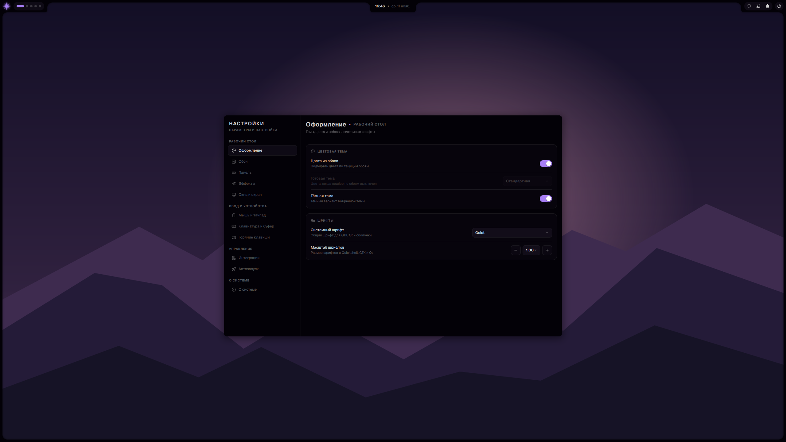
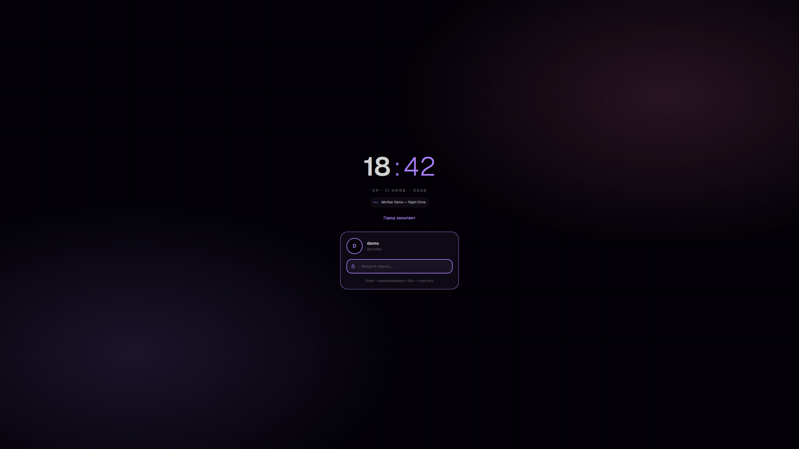
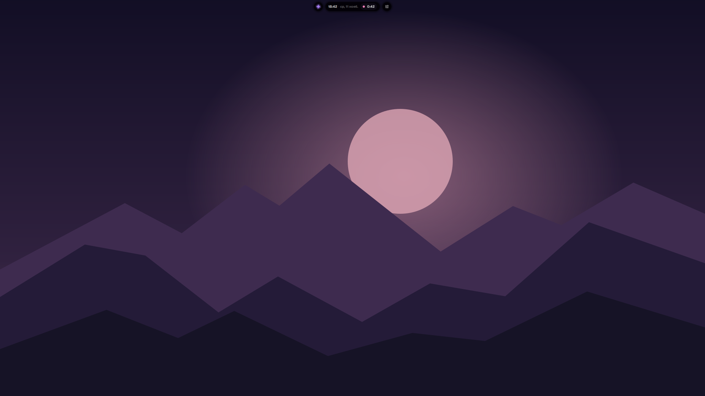
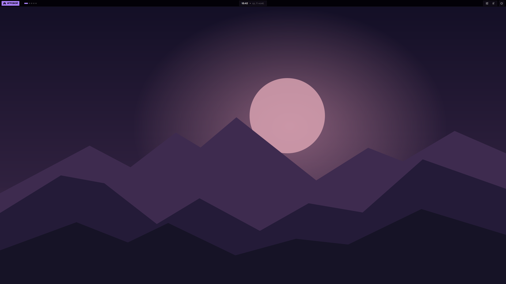
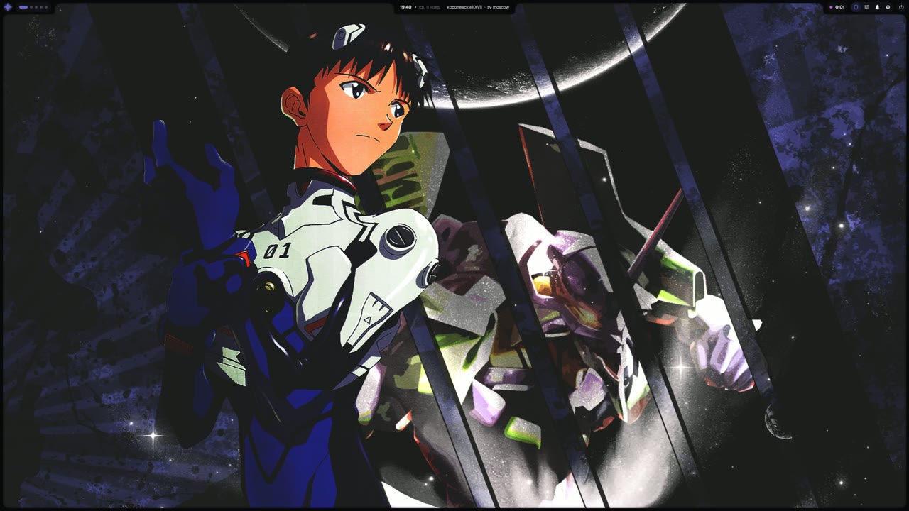

# niri-dots · Minflair

Конфигурация niri и Quickshell для Arch Linux и CachyOS. Панель меняет палитру вместе с обоями, а настройки, лаунчер, экран блокировки и медиаплеер используют одну тему. Интерфейс Minflair на русском, раскладки клавиатуры — US и RU.

Внутри есть лаунчер приложений, история буфера обмена, заметки, центр уведомлений, экран захвата, настройки автозапуска и аватара, а также синхронизированный текст песен в плеере и на экране блокировки.

## Скриншоты

| Рабочий стол и лаунчер | Настройки оформления | Экран блокировки |
|---|---|---|
| [](docs/screenshots/launcher.png) | [](docs/screenshots/settings.png) | [](docs/screenshots/lock-screen.png) |

| Island | Игровой режим |
|---|---|
| [](docs/screenshots/island.png) | [](docs/screenshots/gaming.png) |

**Видеообзор райса · 2 минуты**

[](docs/videos/rice-demo.mp4)

[Открыть видеообзор (MP4, 1440p)](docs/videos/rice-demo.mp4)

**Короткие записи по функциям:** [рабочий стол и виджеты](docs/videos/desktop.mp4) · [окна и обзор niri](docs/videos/window-management.mp4) · [быстрое управление](docs/videos/controls.mp4) · [настройки и пакеты](docs/videos/settings-tour.mp4) · [Convex, Island и Gaming](docs/videos/styles.mp4) · [плеер и блокировка](docs/videos/music-and-lock.mp4).

[Все функции, скриншоты и записи →](docs/features.md)

## Быстрый старт

Нужна Arch-совместимая система с пользовательской сессией systemd и PipeWire. Если Git ещё не установлен, выполни `sudo pacman -S --needed git`. Клонируй репозиторий в постоянную папку и запусти установщик от своего пользователя.

```bash
git clone https://github.com/D3SAY/niri-dots.git ~/niri-dots
cd ~/niri-dots
./install.sh
```

Установщик запрашивает `sudo` для недостающих пакетов. Затем он подключает конфиги niri, Minflair, hypridle, Ghostty и Fastfetch через GNU Stow и проверяет их командой `niri validate`. При конфликте Stow показывает занятые пути. Сохрани эти файлы в резервную копию, убери их с указанных путей и запусти установщик снова.

| Опция | Действие |
|---|---|
| `--dry-run` | Показывает недостающие пакеты и проверяет конфликты, если установлен GNU Stow. |
| `--configs-only` | Подключает конфиги при уже установленных зависимостях. |
| `--gtk-theme` | Подключает тему Material-Gnome. |
| `--lyse` | Подключает обёртку Lyse. Сам Lyse устанавливается отдельно. |
| `--uninstall` | Удаляет ссылки установщика. Пакеты и пользовательские данные остаются. |

Выбери **niri** в своём дисплейном менеджере или запусти `niri-session` из TTY. Первый запуск работает и без сгенерированных настроек темы. Положи свои изображения в `~/Pictures/Wallpapers` и выбери обои через **Ctrl+Alt+W**. При необходимости настрой общее оформление через **Super+,**.

Чтобы отключить конфиги, запусти `./install.sh --uninstall` из той же папки. Если подключал тему или обёртку Lyse, добавь к команде соответствующие опции.

## Возможности и горячие клавиши

| Клавиши | Действие |
|---|---|
| **Super+/** | Шпаргалка горячих клавиш |
| **Alt+Space** | Лаунчер |
| **Super+,** | Настройки |
| **Super+Enter** | Ghostty |
| **Super+V** | История буфера обмена |
| **Ctrl+Alt+S** | Центр управления: звук, микрофон, яркость, сеть, Bluetooth и быстрые переключатели |
| **Ctrl+Alt+A** | Дашборд: игры Steam и обновления системы |
| **Ctrl+Alt+N** | История уведомлений |
| **Ctrl+Alt+O** | Заметки: несколько записей, закрепление, Markdown |
| **Ctrl+Alt+M** | Музыкальная панель, кнопка «Текст» раскрывает слова песни |
| **Ctrl+Alt+W** | Выбор обоев |
| **Ctrl+Alt+P** | Поиск и управление пакетами |
| **Ctrl+Alt+V** | Список VPN-профилей |
| **Print** | Меню захвата экрана |
| **Super+Shift+T** | OCR через NormCap, если установлен |
| **Super+E / M / D / B / S / G** | Loaf / Telegram / Vesktop / Zen / Spotify / Steam, если установлены |
| **Super+I** | Блокировка экрана |
| **Super+Shift+I** | Сон |
| **Super+Shift+Q** | Меню питания |
| **Super+Tab / Q** | Обзор / закрыть окно |
| **Super+1–9 / Super+Ctrl+1–9** | Перейти на рабочий стол / переместить колонку |
| **Super+стрелки / Super+Ctrl+стрелки** | Переместить фокус / переместить окно или колонку |
| **Super+Space / X / T** | Сменить раскладку / вкладки в колонке / плавающее окно |

**Convex** — стандартная панель с рамкой и раскрывающимися блоками. **Island** — компактные островки, которые раскрываются в зависимости от выбранного виджета. Стиль выбирается в **Настройки → Панель**. **Gaming** включается через «Игровой режим» в центре управления и показывает элементы поверх рабочего стола по запросу.

Автозапуск находится в **Настройки → Управление → Автозапуск**. Изменения применяются при следующем входе. Аватар выбирается в **Настройки → О системе → Сменить аватар** и сохраняется в `~/.face`.

## Дополнительные модули

- **Текст песен.** Установи [Lyse](https://github.com/snoowfall/lyse) из AUR. Панель использует установленный `/usr/bin/lyse`; совместимость проверялась с `r17.39ddb35`. Для выбора активного плеера в терминальной версии установи обёртку командой `stow --target="$HOME" --no-folding lyse` и проверь, что `~/.local/bin` идёт перед `/usr/bin` в PATH. Поиск текста в Lyse может отправлять метаданные трека в LRCLIB.
- **Приложения.** `stow --target="$HOME" --no-folding gtk-theme fish fastfetch mpv swayimg loaf` подключает дополнительные конфиги. Устанавливай только нужные пакеты Stow. Для Fish нужны `fish starship lsd`, для MPV — `mpv` и плагины MPRIS/uosc по желанию. Для `loaf` нужен Loaf File Manager. Ярлыки Telegram, Zen, Vesktop, Steam и Spotify требуют соответствующих приложений.
- **Fastfetch** показывает звезду Minflair и системную информацию на русском. Возраст Arch считается в полных днях с установки пакета `base` по журналу Pacman. Если запись недоступна, используется дата создания `/etc`.
- **Шрифты и курсор.** Дизайн использует Geist и Bibata Modern Classic; пакеты `otf-geist` и `bibata-cursor-theme-bin` доступны через AUR. Без них Qt и niri используют доступные системные варианты.
- **Железо.** niri подбирает режим вывода автоматически. Если нужно задать режим и расположение вручную, посмотри имена выходов через `niri msg outputs` и создай `~/.config/niri/outputs.local.kdl`. Номера шин внешних мониторов можно узнать через `ddcutil detect` и добавить свои команды в Fish.
- **Прокси Telegram.** Подключи пакет `tg-ws-proxy` через Stow, установи его исполняемый файл и задай `TG_WS_SECRET` в `~/.config/tg-ws-proxy/env`. Этот файл хранится только локально. Запуск службы — `systemctl --user enable --now tg-ws-proxy`.

## Системные интеграции

Обычной установке они не нужны. Каждая команда ниже выполняется из папки репозитория и меняет только выбранную интеграцию. Посмотреть варианты можно через `./system/install.sh --help`.

| Опция | Что делает |
|---|---|
| `--greetd` | Ставит оформленный экран входа с паролем. Сначала установи greetd. Службу включай отдельно, когда готов переключиться со своего дисплейного менеджера. |
| `--autologin` | Ставит тот же greeter и добавляет автоматический вход при загрузке с последующей блокировкой. Это осознанный opt-in для личной машины: рабочий стол запускается до ввода пароля. Проверь обычный вход и блокировку до включения. |
| `--network-helper` | Устанавливает помощник для VPN и Zapret. Операции используют обычную авторизацию polkit. VPN читает профили из `~/.config/awg` и требует `awg-quick`. |
| `--network-dns` | Переключает NetworkManager на resolvconf и перечитывает DNS. Только для систем с NetworkManager и openresolv. |
| `--zapret` | Устанавливает набор конфигураций для уже установленного Zapret2; сохраняет резервные копии заменяемых файлов. |
| `--virtual-camera` | Устанавливает конфигурацию для уже установленного модуля v4l2loopback. |

Пример установки только greeter: `sudo ./system/install.sh --greetd`. Исходный `/etc/greetd/config.toml` сохраняется с суффиксом `.pre-minflair`. Для возврата восстанови этот файл или отключи greetd и верни прежний дисплейный менеджер.

## Проверка и диагностика

- `niri validate` — проверка конфига после Stow. Отсутствующие необязательные файлы первого запуска могут появиться в предупреждениях.
- `qs list` и `qs log -t 80` — экземпляр Minflair и последние сообщения.
- Для теста блокировки сохрани работу, заблокируй экран, проверь отказ с неверным паролем и вход с паролем своего аккаунта.
- Скрипты запуска и проверки предполагают стандартные пути Arch. При конфликте с существующим конфигом сперва выполни пробный Stow с `--simulate --verbose`.

## Авторы и лицензии

Оболочка основана на [Minflair](https://github.com/t4lentles5/minflair). Текст GPL-3.0 находится в [LICENSE.minflair](quickshell/.config/quickshell/LICENSE.minflair). У темы Material-Gnome свой [файл лицензии](gtk-theme/.themes/Material-Gnome/LICENSE). Заметки вдохновлены [Whisp](https://github.com/tanaybhomia/Whisp); ссылки на источники сохранены в коде. Для остальных файлов отдельная лицензия репозитория пока не выбрана.
